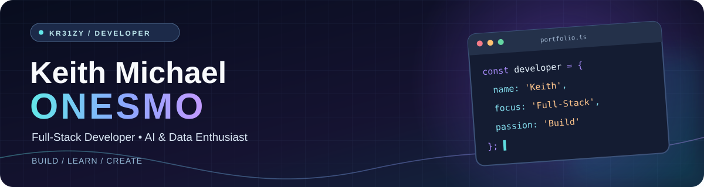

<div align="center">



<br />

<a href="https://git.io/typing-svg"></a>

**Computer Science Student · Software Developer · Tanzania 🇹🇿**

[](https://github.com/KR31zy)
[](https://www.linkedin.com/in/keith-michael-812a0431a)
[](https://github.com/KR31zy?tab=repositories)

</div>

---

### 👨🏽‍💻 About me

```python
keith = {
    "name": "Keith Michael Onesmo",
    "role": "Computer Science Student & Software Developer",
    "focus": ["Full-Stack Development", "AI & Data", "Mobile Apps"],
    "building": "Practical tools with thoughtful user experiences",
    "mindset": "Learn. Build. Improve. Repeat."
}
```

I'm a Computer Science student at **Kampala International University in Tanzania** who enjoys turning ideas into useful products. My interests include building reliable backends, intuitive web/mobile applications, and exploring how AI can solve real problems.

### 🛠️ Languages, frameworks & tools

**Programming & frontend**


**Backend, databases & developer tools**


### 🚀 Featured projects

| Project | Overview | Stack |
|:---|:---|:---|
| 🐄 **[AniRepro360](https://github.com/KR31zy/AniRepro360)** | Animal health and reproductive monitoring platform (in development). | Flutter · FastAPI · PostgreSQL |
| 📓 **[eLogbook](https://github.com/KR31zy/eLogbook)** | Internship and supervisor logbook management project. | Django · PostgreSQL |
| 💻 **[ChakulaSoft](https://github.com/KR31zy/ChakulaSoft)** | Explore this software project repository. | See repository |

> Some project repositories are still being prepared for public release. More documentation and demos are coming.

### 📊 GitHub activity

<div align="center">
  
  
</div>

<sub>Activity cards are provided by a third-party service and may occasionally be rate-limited. Language percentages reflect public GitHub repositories, not all skills.</sub>

### 🤝 Let's connect

- 🔗 **LinkedIn:** [Keith Michael Onesmo](https://www.linkedin.com/in/keith-michael-812a0431a)
- 🧩 **GitHub projects:** [github.com/KR31zy](https://github.com/KR31zy?tab=repositories)

<div align="center">

---

*Build with purpose. Keep learning. Keep shipping.* ✨

</div>
